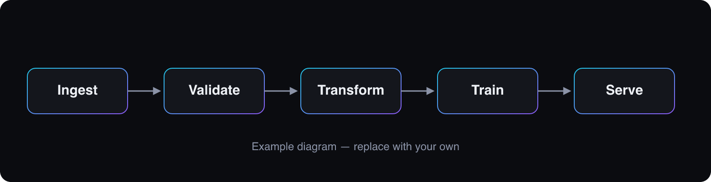

import { Image } from 'astro:assets';
import pipeline from '../../assets/blog/example-post/pipeline.png';

<Callout type="note" title="This is an example post">
  It exists to demonstrate every formatting feature of the blog. Copy
  `src/content/blog/_template.mdx` to start a new post, and delete this one (or set `draft: true`) once you
  have real content.
</Callout>

Body text is set for long-form reading: a comfortable size, a limited line length and generous spacing. You can
use **bold**, _italics_, `inline code`, [links](https://astro.build) and ~~strikethrough~~. Footnotes work too.[^1]

## Headings and the table of contents

Every `##` and `###` heading shows up in the table of contents. On large screens it sticks to the right side,
on mobile it folds up at the top. Hover a heading to see its anchor link.

### A third-level heading

Use `###` for subsections. Avoid going deeper than `####`; if you need to, the section probably wants to be split.

## Code blocks

Code is highlighted at build time with Shiki (no JavaScript shipped), switches with the colour theme, and gets a
copy button. Here is a numerically stable softmax cross-entropy in Python:

```python
import numpy as np


def log_softmax(logits: np.ndarray) -> np.ndarray:
    """Numerically stable log-softmax along the last axis."""
    shifted = logits - logits.max(axis=-1, keepdims=True)
    return shifted - np.log(np.exp(shifted).sum(axis=-1, keepdims=True))


def cross_entropy(logits: np.ndarray, targets: np.ndarray) -> float:
    log_probs = log_softmax(logits)
    return float(-log_probs[np.arange(len(targets)), targets].mean())


logits = np.array([[2.0, 0.5, -1.0], [0.1, 0.2, 3.0]])
print(cross_entropy(logits, np.array([0, 2])))
```

And a small typed retry helper in TypeScript:

```ts
type RetryOptions = { retries?: number; baseDelayMs?: number };

export async function withRetry<T>(
  fn: () => Promise<T>,
  { retries = 3, baseDelayMs = 250 }: RetryOptions = {},
): Promise<T> {
  for (let attempt = 0; ; attempt++) {
    try {
      return await fn();
    } catch (error) {
      if (attempt >= retries) throw error;
      // Exponential backoff with jitter.
      const delay = baseDelayMs * 2 ** attempt * (0.5 + Math.random());
      await new Promise((resolve) => setTimeout(resolve, delay));
    }
  }
}
```

Shell snippets work the same way:

```bash
npm run dev
```

## Math

Inline math uses single dollars: the softmax of a logit vector $z \in \mathbb{R}^K$ is
$\sigma(z)_i = e^{z_i} / \sum_j e^{z_j}$. Display math uses double dollars:

$$
\mathcal{L}(\theta) = -\frac{1}{N} \sum_{n=1}^{N} \log \frac{\exp\left(f_\theta(x_n)_{y_n}\right)}{\sum_{k=1}^{K} \exp\left(f_\theta(x_n)_k\right)}
$$

The KaTeX stylesheet is only loaded on posts that actually contain math.

## Callouts

There are four variants, and you can use them in any `.mdx` post without importing anything:

<Callout type="tip">
  Keep callouts short. One or two sentences that the reader should not miss.
</Callout>

<Callout type="warning" title="Data leakage">
  Fit your scalers and encoders on the training split only, then apply them to validation and test data.
</Callout>

<Callout type="danger">
  Never commit API keys. Use environment variables or a secret manager.
</Callout>

## Images

Images stored next to your posts are optimised automatically (resized, converted to modern formats, lazy-loaded,
with `srcset`). Plain Markdown syntax works:



For a caption, use the `Image` component inside a `figure`:

<figure>
  <Image src={pipeline} alt="A five-step ML pipeline: ingest, validate, transform, train, serve." />
  <figcaption>A typical batch ML pipeline. Each stage should be independently testable.</figcaption>
</figure>

## Tables

| Model               | Params | Training data       | Notes                  |
| ------------------- | -----: | ------------------- | ---------------------- |
| Logistic regression |    10³ | Real tabular data   | Strong, cheap baseline |
| Gradient boosting   |    10⁵ | Real tabular data   | Default for tabular    |
| TabPFN              |    10⁷ | Synthetic (prior)   | In-context learning    |

Wide tables scroll horizontally on small screens instead of breaking the layout.

## Lists and quotes

1. Ordered lists for sequences
2. …like setup steps
   - with nested bullets
   - when needed

- [x] Task lists work
- [ ] And can be left unchecked

> Make it work, make it right, make it fast.
>
> Kent Beck

[^1]: Footnotes are collected at the bottom of the post with back-links.
